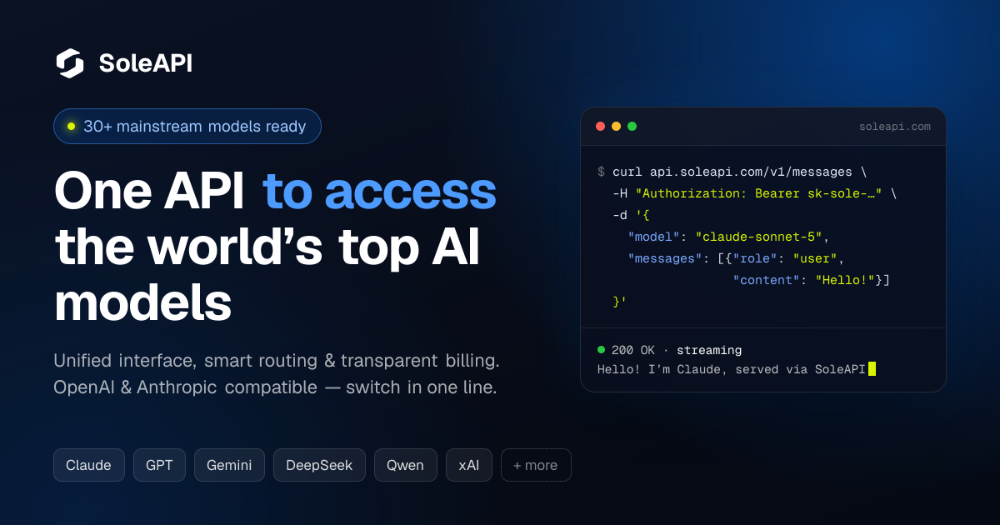

<picture>
  <source media="(prefers-color-scheme: dark)" srcset="assets/banner-dark.svg">
  
</picture>

全栈开发者，专注 AI 基础设施。以 Go 与 Java（Spring Cloud）构建高并发 API 网关、微服务与模型中转服务，以 TypeScript / Vue / Next.js 构建管理台与业务应用，熟悉 Kubernetes 与 Docker 部署。

- 正在构建 [SoleAPI](https://soleapi.com)，面向生产环境的 LLM API 网关
- 关注方向：LLM 流量调度、计费与对账、流式转发的稳定性
- 联系方式：admin@oryntis.ai

## 技术栈

<picture>
  <source media="(prefers-color-scheme: dark)" srcset="assets/stack-dark.svg">
  
</picture>

## 产品

 

<picture>
  <source media="(prefers-color-scheme: dark)" srcset="assets/stats-dark.svg">
  
</picture>
