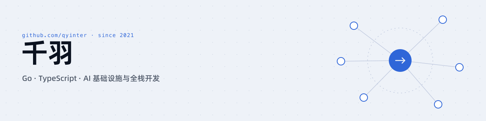
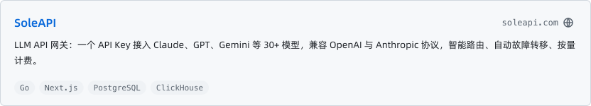
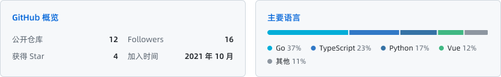

<picture>
  <source media="(prefers-color-scheme: dark)" srcset="assets/banner-dark.svg">
  
</picture>

全栈开发者，专注 AI 基础设施。以 Go 构建高并发 API 网关与模型中转服务，以 TypeScript / Vue / Next.js 构建管理台与业务应用。

- 正在构建 [SoleAPI](https://soleapi.com)，面向生产环境的 LLM API 网关
- 关注方向：LLM 流量调度、计费与对账、流式转发的稳定性
- 联系方式：[YOUR EMAIL]

## 技术栈

<picture>
  <source media="(prefers-color-scheme: dark)" srcset="assets/stack-dark.svg">
  
</picture>

## 产品

<a href="https://soleapi.com">
  <picture>
    <source media="(prefers-color-scheme: dark)" srcset="assets/product-dark.svg">
    
  </picture>
</a>

 

<picture>
  <source media="(prefers-color-scheme: dark)" srcset="assets/stats-dark.svg">
  
</picture>
